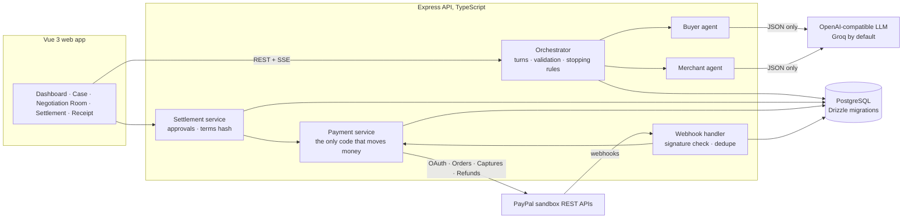

# ResolveOS

**Two sides. One resolution.**

ResolveOS is a pre-dispute payment resolution app. When a completed PayPal payment goes wrong, a
**buyer agent** and a **merchant agent** look at the evidence and negotiate a fair settlement. Each
agent stays within its own side's private limits. A **deterministic orchestrator** checks every move
the agents make. **Both people approve** the exact terms. Only then does ResolveOS run the **refund
through PayPal's real sandbox API** and show a receipt with PayPal's refund ID.

> Independent hackathon project for the PayPal AI Hackathon 2026. It is not affiliated with or
> endorsed by PayPal. It runs on the **PayPal sandbox with test money only**. It does not replace
> PayPal's Resolution Center or guarantee PayPal Buyer or Seller Protection outcomes.

---

## The problem

A customer buys a $180 jacket. The carrier says it was delivered; the customer says it never
arrived. There is no signature and no photo. Both sides are acting in good faith, but the evidence
is incomplete, and a formal dispute costs both of them time, fees and the relationship.

PayPal's Resolution Center already lets the two sides message and make offers **once a dispute is
open**. ResolveOS works one step earlier, **before** a dispute: each side gets its own AI advocate
with private limits, and a compromise both people approve is settled as a real PayPal refund.

## What happens in the demo

1. **Buyer reports a problem** on a real PayPal sandbox payment. ResolveOS reads the capture from
   PayPal and marks it *Verified from PayPal*.
2. **The merchant may add evidence**, such as a tracking record or a refund policy, and sets a private
   refund ceiling.
3. **Two AI agents negotiate** in the Negotiation Room. They cite evidence by code, list what is
   unproven, and make structured offers. A *gap meter* shows the two positions closing in.
4. **Both parties approve** the exact terms, each from their own signed-in session.
5. **PayPal processes the refund** against the original capture, using an idempotency key.
6. **A verified settlement receipt** shows PayPal's refund ID, the capture ID and the full audit trail.

If the evidence cannot support a fair deal, the agents **do not force one**: the case ends with no
agreement or with escalation, and no payment is made (seeded case RA-1043).

## The AI team

Five AI roles work on a case. Only two of them negotiate, and none can move money.

| Role | Job | What it can reach |
| --- | --- | --- |
| **Injection screen** | Flags party text written to manipulate an AI, using app-specific patterns and Llama Prompt Guard 2 | The text only |
| **Case investigator** | Chooses which PayPal records to check, then tests each side's claims against them | Three read-only checks through the **PayPal Agent Toolkit** |
| **Buyer agent** | Negotiates for the buyer, within the buyer's private minimum | Case facts, its own limit |
| **Merchant agent** | Negotiates for the merchant, within its private limit | Case facts, its own limit |
| **Independent reviewer** | Tells both people whether the agreed terms fit the evidence, and what each side gives up | Case facts, never either limit |

The server writes the PayPal results itself, so a model cannot invent "verified by PayPal" evidence.
Only a PayPal record can mark a claim supported or contradicted. If PayPal shows a formal dispute
already open, the case stops, whether or not the investigator chose to look.

**Why the agents do not hold the toolkit:** in version 1.11.0 its `actions` setting hides tools from
the model, but `handleToolCall` still runs any tool it is given by name, including `create_refund`.
The investigator therefore picks from three named checks with no arguments, and
`paypal/read-tools.ts` calls fixed tool names with IDs from the database.

## How it keeps money safe

| Rule | Where it's enforced |
| --- | --- |
| Agents can only **propose**. They have no tools, and no access to payments or approvals. | `negotiation/orchestrator.ts` |
| Every agent answer must pass a **schema check, then server checks**: evidence codes exist, the currency matches, a full refund is exactly the refundable amount, the merchant agent never exceeds the merchant's limit, the buyer agent never goes below the buyer's floor, and "accept" really matches the other side's offer. A rejected answer is retried once, then reported as an error. Nothing is ever invented in its place. | `validateTurn` |
| Each side's **private limit is hidden** from the other side, both from that side's agent and in the API. | `prompts.ts`, `routes/cases.ts` |
| A refund needs **both approvals of the same terms hash**. Changing any term means earlier approvals no longer count. | `settlement/service.ts`, `settlement/terms.ts` |
| The refund endpoint takes **only a case ID**. Amount, capture and currency are loaded from the approved settlement. | `payments/service.ts` |
| **No duplicate refunds**: a row lock, a unique refund attempt per proposal, and a fixed `PayPal-Request-Id`. | `executeApprovedRefund` |
| A timeout is **"unknown, needs reconciling"**, never "failed". Reconciling re-sends the same request ID, so PayPal returns the original result. | `reconcileRefund` |
| A refund is shown as successful **only when PayPal reports `COMPLETED`**. | receipt, settlement screens |
| Seeded demo data can never be refunded. A database constraint stops seeded rows from holding PayPal IDs. | `db/schema.ts` |
| Webhooks are **signature-verified** against the raw body. The certificate URL must be a PayPal host. Unverified events are quarantined, events are deduplicated by ID, and **the outcome comes from a fresh PayPal lookup**, never from the event. | `paypal/webhook-verify.ts`, `payments/webhooks.ts` |
| Anything short of a **definite PayPal refusal** stays "unknown": a 409, 429, unreadable answer, sign-in failure or bug never reopens the case, because new terms get a new request ID. | `payments/service.ts` |
| An agent answer that writes its own private limit, cites evidence that does not exist, takes a position with no evidence, retreats from its own last offer, or settles a buyer on a replacement they did not ask for is rejected. Rejection reasons in the shared log never contain a limit. | `validateTurn` |
| Negotiation cannot start until the **merchant has confirmed** its limit for the case. | `Orchestrator.start` |
| A **deterministic eligibility screen** runs before any agent: possible unauthorised payments or account takeover, and fully refunded payments, are escalated to PayPal without negotiating. | `negotiation/eligibility.ts` |
| Party-written text cannot close the data tags around it in the prompt. | `prompts.ts` |
| A public instance **will not start** without `DEMO_ACCESS_CODE` and an https `FRONTEND_URL`. | `config.ts`, `accessGate` |
| Sessions use HTTP-only `SameSite=Strict` cookies plus a CSRF token. Roles come from the database. The operator can watch but cannot approve. | `auth.ts` |

## Architecture



**Stack:**
- **Frontend:** Vue 3, TypeScript, Vite, Tailwind CSS v4, Pinia, Vue Router, lucide icons.
- **Backend:** Node.js, TypeScript, Express 5, Zod, Drizzle ORM, PostgreSQL (local, or Neon).
- **Tests:** Vitest, Supertest, Playwright.

**PayPal APIs used:**

| Endpoint | Purpose |
| --- | --- |
| `POST /v1/oauth2/token` | access token |
| `POST /v2/checkout/orders` | create order |
| `POST /v2/checkout/orders/{id}/capture` | capture |
| `GET /v2/payments/captures/{id}` | verified evidence |
| `POST /v2/payments/captures/{id}/refund` | full or partial refund, with `PayPal-Request-Id` |
| `GET /v2/payments/refunds/{id}` | reconcile |
| Webhooks | `PAYMENT.CAPTURE.REFUNDED`, `PAYMENT.CAPTURE.COMPLETED`, `PAYMENT.REFUND.PENDING`, `.FAILED`, `.DENIED`, `.CANCELLED`, `CUSTOMER.DISPUTE.CREATED` |

**AI used:** any OpenAI-compatible chat API, through a small provider interface
(`apps/server/src/ai/provider.ts`). We use **Groq** with `openai/gpt-oss-120b` in JSON mode. Each
agent turn is one model call that returns a structured `AgentTurn` (reasoning, evidence codes,
uncertainties, the options it weighed, and an offer), which the server validates.

**Demo engine:** for presentations without a key, a clearly labelled deterministic negotiator
computes its turns from the case's own numbers and evidence. The UI marks every such turn
*Demo engine*. Code assistants (Claude Code) were also used while building.

## Run it locally

Everything here is free: the PayPal sandbox, a free Groq key and local PostgreSQL.

**Prerequisites:**
- Node 22+ and pnpm 12
- PostgreSQL 15+ running locally, or a free Neon database

```bash
pnpm install
cp .env.example .env
```

Then fill in `.env`:

| Variable | Where to get it |
| --- | --- |
| `DATABASE_URL` | `postgres://localhost:5432/resolve_ai` (create it first with `createdb resolve_ai`), or a Neon connection string |
| `SESSION_SECRET` | `openssl rand -hex 32` |
| `PAYPAL_CLIENT_ID`, `PAYPAL_CLIENT_SECRET` | developer.paypal.com → toggle **Sandbox** → Apps & Credentials → Create App (type **Merchant**) → copy the Client ID and **Secret key 1** |
| `AI_API_BASE_URL`, `AI_API_KEY`, `AI_MODEL` | console.groq.com → API Keys (free). Use `https://api.groq.com/openai/v1` and `openai/gpt-oss-120b` |
| `PAYPAL_WEBHOOK_ID` | Optional; see *Webhooks* below |
| `AI_MODE` | `live` (default) or `demo` |
| `AI_MODEL_ANALYST`, `AI_MODEL_FALLBACK`, `AI_MODEL_GUARD` | Optional. Models for the investigator and reviewer, for when the main model's free allowance runs out, and for the injection screen |
| `FRONTEND_URL`, `BACKEND_PORT` | Defaults suit local use; see *Deploying* for a public instance |
| `DEMO_ACCESS_CODE` | Not needed locally. **Required** when `NODE_ENV=production` |
| `RATE_LIMIT_MAX` | Optional override of the per-minute limits |

Without PayPal keys the app still runs, but payments and refunds are disabled. Without an AI key,
only the labelled demo engine is available.

```bash
pnpm db:migrate      # create the tables
pnpm db:seed         # demo people + 2 seeded cases, ONLY into an empty database (never deletes)
pnpm paypal:check    # proves your sandbox keys: OAuth + creates an unpaid $1 order
pnpm dev             # API on :5001, web app on http://localhost:5180
```

Open **http://localhost:5180** and click **Enter ResolveOS**.

### Demo walkthrough (about 3 minutes)

For a hosted recording, use **https://resolveos-paypal.onrender.com**, not `pnpm dev`. Make a fresh Sandbox purchase and case. Live AI outcomes vary: do not substitute an earlier case's refund receipt for a new case. Render Free may require a cold start after inactivity.


1. Sign in as **Alex Morgan** (buyer). Go to **Sandbox purchase** → **Pay with PayPal sandbox**.
2. On PayPal's sandbox page, log in with your **sandbox personal account**: developer.paypal.com →
   Testing Tools → Sandbox Accounts → the *Personal* account → View/Edit for its email and password.
   Then pay. You return to ResolveOS with the capture ID.
3. **Report a problem with this order** → *Fill in the "missing jacket" scenario* → **Open case**.
4. Use the header menu to switch to **Jordan Ellis** (merchant) and open the case. Click **Add
   evidence** → *Demo tracking record* → Add. Set *Most we would refund* (e.g. 120.00) and click
   **Save limits**. Negotiation cannot start until the merchant has done this.
5. **Go to negotiation** → **Live AI** → **Start negotiation** → **Run to a result**.
6. **Review & approve** as Jordan, switch to Alex, and **Approve**. The refund runs on PayPal.
7. **View receipt**: PayPal refund ID, capture ID, status `COMPLETED`, and the audit trail.

Also try seeded case **RA-1043** (as Priya Nair). The agents cannot agree, and nothing is paid.

### Manual sandbox test (without the UI)

```bash
pnpm paypal:prove order              # creates a real $180 sandbox order and prints the approval link
pnpm paypal:prove finish <orderId>   # capture → refund $90 → same request id again → same refund
```

### Webhooks (optional)

PayPal only delivers webhooks to a public HTTPS URL. A free tunnel such as `cloudflared` works:

```bash
cloudflared tunnel --url http://localhost:5001
```

1. Run `pnpm paypal:webhook https://<tunnel>`. It registers the webhook and every event above on
   your sandbox app, or finds the existing one, and prints the ID.
2. Put the ID in `PAYPAL_WEBHOOK_ID` and restart.

What an event does: a signed refund event makes the server ask PayPal for that refund and apply
PayPal's answer, so events can arrive twice or out of order. If PayPal can't be reached the server
answers 503 and PayPal delivers it again. A new PayPal dispute escalates an unfinished case and
cancels any settlement not yet paid. Open pages update through Server-Sent Events.

Without webhooks, refunds are still confirmed from PayPal's API responses, and the server checks
pending ones with PayPal every minute (read-only; it never sends a refund).

### Resetting demo data (destructive, explicit)

**For the hosted hackathon recording, DO NOT reset Neon or run `pnpm db:reset --yes`.** Create a new Sandbox transaction and case instead. Keep completed settlements and audit trails. The reset command below is only for a disposable *local test* database.


`pnpm db:seed` never deletes anything: if the database already has data, it changes nothing.
To wipe this app's records (cases, payments, refunds) and start again:

```bash
pnpm db:reset          # shows what would be deleted; changes nothing
pnpm db:reset --yes    # deletes everything in this app's database, then re-creates the demo data
```

In the app, only the **Demo Operator** can reset, and only after confirming. Both are refused when
`NODE_ENV=production`. PayPal itself is never touched: sandbox payments and refunds stay in PayPal.

## Deploying a public instance

Demo sign-in has no passwords, so a public instance must not be open to everyone. In production the
server refuses to start without `DEMO_ACCESS_CODE` (16+ characters), and every page and API call
then needs that code: the browser asks once (HTTP Basic; any username). Only `/api/health`,
`/api/ready` and PayPal's signature-checked webhook are outside it.

`render.yaml` describes the same setup for Render's free web service; a free Neon database works
with it. It is deployed at https://resolveos-paypal.onrender.com (PayPal Sandbox only). The hosted demo has completed a two-party-approved refund and verified capture/refund webhook deliveries.

```bash
pnpm install --frozen-lockfile
pnpm build
pnpm db:migrate && pnpm db:seed
pnpm --filter server start   # serves the API and the built web app from one origin
```

Set these in the host's environment, not in a file in the repo:

| Variable | Value |
| --- | --- |
| `NODE_ENV` | `production` |
| `FRONTEND_URL` | The public `https://` address. PayPal's return and cancel URLs are built from it |
| `BACKEND_PORT` | The port your host expects the app to listen on |
| `DEMO_ACCESS_CODE` | `openssl rand -hex 16`; share it only with people testing the demo |
| `DATABASE_URL`, `SESSION_SECRET`, `PAYPAL_*`, `AI_*` | As for local use, with sandbox credentials |

Point health checks at `/api/ready`. For live webhooks, register
`https://<your host>/api/paypal/webhooks` and set `PAYPAL_WEBHOOK_ID`.

## Security

- **Secrets** stay in server-side environment variables. `.env` is git-ignored; the browser build
  contains none of them.
- **Access:** per-case checks on every route (a stranger gets 404), roles from the database, CSRF
  tokens on writes, `SameSite=Strict`, HTTP-only cookies that are `Secure` in production.
- **Abuse limits:** per-IP rate limits on sign-in, payments, negotiation, webhooks and failed access
  codes; size limits on request bodies; schema validation on every input.
- **Webhooks:** signature checked on the raw bytes, certificate fetched only from PayPal's
  certificate path, events deduplicated by ID so replays change nothing.
- **Errors:** one error shape; stack traces stay in the server log.

No system can be promised to be unhackable. Known gaps are listed under *Known limitations*.

## Negotiation evaluation

`createdb resolve_ai_eval && pnpm eval --engines=baseline,ai --reps=3` compares the AI agents with a
rules-based baseline on 7 scripted scenarios (separate database). Method, results and limits are in
[`docs/EVALUATION.md`](docs/EVALUATION.md).

## Tests

```bash
pnpm --filter server test   # 172 API tests on a real Postgres test DB (createdb resolve_ai_test)
pnpm --filter web test      # unit tests for money parsing, stages and wording
pnpm test:e2e               # Playwright: createdb resolve_ai_e2e first; uses your installed Chrome
```

**API tests cover:**
- exact refund amounts and full-refund semantics;
- no duplicate refund under concurrent clicks;
- both approvals required, stale versions refused, and changed terms refused;
- seeded data never refunded;
- the caller cannot supply an amount or capture;
- timeouts reconciled with the same request ID;
- PayPal rejections and pending refunds;
- CSRF protection, plus cross-user and operator boundaries;
- webhook verification, deduplication and quarantine;
- every check on agent output;
- deadlock, escalation, revision and rejection;
- answers from PayPal that prove nothing (bad JSON, 409, 429, 401, crashes part-way);
- private limits in agent text, in the audit log and in API responses;
- production start-up rules, the access gate, cookies, rate limits and malformed input.

**End-to-end tests** use the mock PayPal adapter (`PAYPAL_ADAPTER=mock`, which the app refuses in
production) and the deterministic demo engine. They cover:
- purchase → report → negotiate → two approvals → refund → receipt, including after a reload;
- no agreement, rejection, and revision followed by new terms;
- waiting for the merchant, the merchant's limit binding the result, and each side's privacy;
- repeated captures and refund requests never paying twice;
- refund timeouts with reconciliation, pending refunds and PayPal refusals;
- how API failures and rate limiting are shown;
- switching person, the operator's limits, and seeded data never refunding;
- the investigator's brief and the independent review being shown.

## API

All responses use one error shape: `{ error: { code, message, details? } }`. Writes need the
`X-CSRF-Token` header from `/api/auth/login` or `/api/auth/me`.

| Area | Endpoints |
| --- | --- |
| Auth | `GET /api/auth/demo-accounts` · `POST /api/auth/login` `{userId}` · `POST /api/auth/logout` · `GET /api/auth/me` |
| PayPal | `GET /api/paypal/status` · `POST /api/paypal/orders` · `POST /api/paypal/orders/:orderId/capture` · `POST /api/paypal/refunds/execute` `{caseId}` · `POST /api/paypal/refunds/reconcile` `{caseId}` · `POST /api/paypal/webhooks` |
| Cases | `GET /api/cases?status&q` · `POST /api/cases` · `GET /api/cases/:id` · `POST /api/cases/:id/evidence` · `PATCH /api/cases/:id/merchant-terms` · `GET /api/transactions` · `GET /api/merchants` |
| Negotiation | `POST /api/cases/:id/negotiate/start` `{mode: live\|demo}` · `POST …/advance` · `POST …/run` · `GET …/history` · `GET /api/cases/:id/events` (SSE) |
| Settlement | `GET /api/cases/:id/settlement` · `POST …/settlement/approve\|reject\|revise` `{proposalVersion, note?}` · `GET /api/cases/:id/receipt` |
| Dashboard | `GET /api/dashboard/summary` · `GET /api/dashboard/activity` |
| Demo | `POST /api/demo/reset` |

## Project layout

```
apps/server/src
  paypal/       client.ts (REST client), webhook-verify.ts, fake.ts (test-only mock)
  payments/     service.ts (orders, captures, refunds, reconcile), webhooks.ts
  negotiation/  orchestrator.ts, engines.ts (live / demo), prompts.ts, turn.ts (schema)
  settlement/   service.ts (approvals), terms.ts (terms hash)
  routes/       cases.ts (cases, evidence, negotiation, settlement, dashboard, demo)
  db/           schema.ts, migrations in ../drizzle, seed.ts
apps/web/src    views/ (12 screens), components/, api/, lib/
e2e/            Playwright specs
```

## Known limitations

- **Eligibility screen uses text patterns.** Possible unauthorised payments or account takeover are
  sent to PayPal before any agent runs, but a claim worded differently could be missed, and an
  ordinary complaint could be flagged. A false positive only means a person handles it.
- **Evaluation is small.** 7 scripted scenarios, 3 AI runs each, written by us, recorded before the
  final agent changes. Only a 3-run spot check covers the final code. See `docs/EVALUATION.md`.
- **Dependency advisories remain in the PayPal Agent Toolkit's own packages:** one high (`zod` 3, memory
  use on oversized collections) and two low. The app gives the toolkit only fixed tool names and
  server-held ids, so party text does not reach that validation; the patch needs a toolkit update.
- **Sandbox only.** Live PayPal credentials and real money are out of scope.
- **Authentication is demo-grade:** pick a seeded person, no passwords. Sessions are real and roles
  are enforced on the server, but anyone past the access code can act as any demo person. Do not
  use this for real accounts or real money.
- **The injection screen is a filter, not a guarantee.** In testing, Prompt Guard alone missed an
  injection aimed at this app, so app-specific patterns run first. A reworded attack can still pass;
  the server's limits and the two human approvals do not depend on the screen.
- **Tracking is only what the merchant registered.** PayPal records it; it does not prove delivery.
- **The private-limit check looks for written amounts.** An agent that hinted at its limit in words
  ("about a hundred and twenty") would not be caught.
- **Rate limits are per process and per IP**, held in memory. They reset on restart.
- **Webhook replay** is stopped by event ID, not by the age of the transmission.
- **Evidence is text,** entered by the parties or seeded; there is no file upload. Shipping data is
  not fetched from carriers.
- **Replacement** can be agreed, but ResolveOS does not ship anything; it is flagged as a manual
  action for the merchant.
- **AI rate limits:** Groq free-tier quotas can change or be exhausted. Live negotiation may pause or fail; the distinct, labelled demo engine can be used for offline presentations.
- **A refund started outside ResolveOS** is ignored by the webhook and does not change the recorded
  refunded total. PayPal still refuses to refund more than remains.
- **Live webhook delivery:** verified on the hosted Sandbox instance. PayPal's event history shows **Success** for the capture-completed and capture-refunded notifications from case RA-1100. Other subscribed event types and failure/retry paths were not individually tested.
- **Postgres tests:** server tests need a local Postgres test database.

## Sponsor tools

| Tool | What it does here | How to check |
| --- | --- | --- |
| **PayPal** REST APIs, webhooks | Payments, refunds and event-driven case updates, sandbox only | See above |
| **PayPal Agent Toolkit** | The case investigator's read-only PayPal lookups | `paypal/read-tools.ts` |
| **Postman** | 44-request collection of the full journey and its refusals: authorisation, CSRF, invalid input, duplicates, settlement approval, forged webhooks. No secrets | `postman/README.md` |

## Submission material

- `docs/DEVPOST.md`: the submission text (problem, solution, measured impact, USP).
- `docs/EVALUATION.md`: AI vs rules-based baseline on 7 scenarios, with limitations.
- `docs/VIDEO_SCRIPT.md`: the timed script for the 3-minute demo video.

## License

[MIT](LICENSE)
