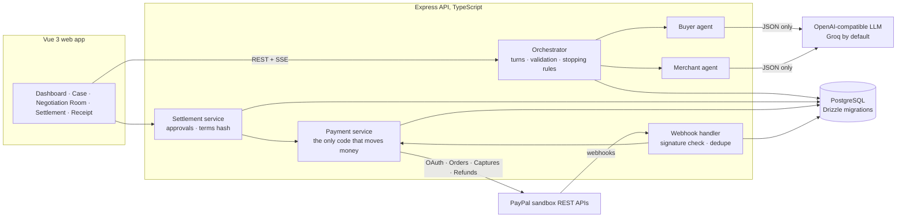

# ResolveOS

**Two sides. One resolution.**

ResolveOS is a pre-dispute payment resolution app. When a completed PayPal payment goes wrong, a
**buyer agent** and a **merchant agent** look at the evidence and negotiate a fair settlement. Each
agent stays within its own side's private limits. A **deterministic orchestrator** checks every move
the agents make. **Both people approve** the exact terms. Only then does ResolveOS run the **refund
through PayPal's real sandbox API** and show a receipt with PayPal's refund ID.

> Independent hackathon project for the PayPal AI Hackathon 2026. It is not affiliated with or
> endorsed by PayPal. It runs on the **PayPal sandbox with test money only**. It does not replace
> PayPal's Resolution Center or guarantee PayPal Buyer or Seller Protection outcomes.

---

## The problem

A customer buys a $180 jacket. The carrier says it was delivered; the customer says it never
arrived. There is no signature and no photo. Both sides are acting in good faith, but the evidence
is incomplete, and a formal dispute costs both of them time, fees and the relationship.

PayPal's Resolution Center already lets the two sides message and make offers **once a dispute is
open**. ResolveOS works one step earlier, **before** a dispute: each side gets its own AI advocate
with private limits, and a compromise both people approve is settled as a real PayPal refund.

## What happens in the demo

1. **Buyer reports a problem** on a real PayPal sandbox payment. ResolveOS reads the capture from
   PayPal and marks it *Verified from PayPal*.
2. **The merchant adds evidence**, such as a tracking record or a refund policy, and sets a private
   refund ceiling.
3. **Two AI agents negotiate** in the Negotiation Room. They cite evidence by code, list what is
   unproven, and make structured offers. A *gap meter* shows the two positions closing in.
4. **Both parties approve** the exact terms, each from their own signed-in session.
5. **PayPal processes the refund** against the original capture, using an idempotency key.
6. **A verified settlement receipt** shows PayPal's refund ID, the capture ID and the full audit trail.

If the evidence cannot support a fair deal, the agents **do not force one**: the case ends with no
agreement or with escalation, and no payment is made (seeded case RA-1043).

## How it keeps money safe

| Rule | Where it's enforced |
| --- | --- |
| Agents can only **propose**. They have no tools, and no access to payments or approvals. | `negotiation/orchestrator.ts` |
| Every agent answer must pass a **schema check, then server checks**: evidence codes exist, the currency matches, a full refund is exactly the refundable amount, the merchant agent never exceeds the merchant's limit, the buyer agent never goes below the buyer's floor, and "accept" really matches the other side's offer. A rejected answer is retried once, then reported as an error. Nothing is ever invented in its place. | `validateTurn` |
| Each side's **private limit is hidden** from the other side, both from that side's agent and in the API. | `prompts.ts`, `routes/cases.ts` |
| A refund needs **both approvals of the same terms hash**. Changing any term means earlier approvals no longer count. | `settlement/service.ts`, `settlement/terms.ts` |
| The refund endpoint takes **only a case ID**. Amount, capture and currency are loaded from the approved settlement. | `payments/service.ts` |
| **No duplicate refunds**: a row lock, a unique refund attempt per proposal, and a fixed `PayPal-Request-Id`. | `executeApprovedRefund` |
| A timeout is **"unknown, needs reconciling"**, never "failed". Reconciling re-sends the same request ID, so PayPal returns the original result. | `reconcileRefund` |
| A refund is shown as successful **only when PayPal reports `COMPLETED`**. | receipt, settlement screens |
| Seeded demo data can never be refunded. A database constraint stops seeded rows from holding PayPal IDs. | `db/schema.ts` |
| Webhooks are **signature-verified** against the raw body. The certificate URL must be a PayPal host. Unverified events are quarantined, and events are deduplicated by ID. | `paypal/webhook-verify.ts`, `payments/webhooks.ts` |
| Sessions use HTTP-only `SameSite=Strict` cookies plus a CSRF token. Roles come from the database. The operator can watch but cannot approve. | `auth.ts` |

## Architecture



**Stack:**
- **Frontend:** Vue 3, TypeScript, Vite, Tailwind CSS v4, Pinia, Vue Router, lucide icons.
- **Backend:** Node.js, TypeScript, Express 5, Zod, Drizzle ORM, PostgreSQL (local, or Neon).
- **Tests:** Vitest, Supertest, Playwright.

**PayPal APIs used:**

| Endpoint | Purpose |
| --- | --- |
| `POST /v1/oauth2/token` | access token |
| `POST /v2/checkout/orders` | create order |
| `POST /v2/checkout/orders/{id}/capture` | capture |
| `GET /v2/payments/captures/{id}` | verified evidence |
| `POST /v2/payments/captures/{id}/refund` | full or partial refund, with `PayPal-Request-Id` |
| `GET /v2/payments/refunds/{id}` | reconcile |
| Webhooks | `PAYMENT.CAPTURE.REFUNDED`, `PAYMENT.REFUND.PENDING`, `PAYMENT.REFUND.FAILED`, `PAYMENT.CAPTURE.COMPLETED` |

**AI used:** any OpenAI-compatible chat API, through a small provider interface
(`apps/server/src/ai/provider.ts`). We use **Groq** with `openai/gpt-oss-120b` in JSON mode. Each
agent turn is one model call that returns a structured `AgentTurn`, which the server validates.

**Demo engine:** for presentations without a key, a clearly labelled deterministic negotiator
computes its turns from the case's own numbers and evidence. The UI marks every such turn
*Demo engine*. Code assistants (Claude Code) were also used while building.

## Run it locally

Everything here is free: the PayPal sandbox, a free Groq key and local PostgreSQL.

**Prerequisites:**
- Node 22+ and pnpm 10+
- PostgreSQL 15+ running locally, or a free Neon database

```bash
pnpm install
cp .env.example .env
```

Then fill in `.env`:

| Variable | Where to get it |
| --- | --- |
| `DATABASE_URL` | `postgres://localhost:5432/resolve_ai` (create it first with `createdb resolve_ai`), or a Neon connection string |
| `SESSION_SECRET` | `openssl rand -hex 32` |
| `PAYPAL_CLIENT_ID`, `PAYPAL_CLIENT_SECRET` | developer.paypal.com → toggle **Sandbox** → Apps & Credentials → Create App (type **Merchant**) → copy the Client ID and **Secret key 1** |
| `AI_API_BASE_URL`, `AI_API_KEY`, `AI_MODEL` | console.groq.com → API Keys (free). Use `https://api.groq.com/openai/v1` and `openai/gpt-oss-120b` |
| `PAYPAL_WEBHOOK_ID` | Optional; see *Webhooks* below |

Without PayPal keys the app still runs, but payments and refunds are disabled. Without an AI key,
only the labelled demo engine is available.

```bash
pnpm db:migrate      # create the tables
pnpm db:seed         # demo people + 2 seeded cases (RA-1042, RA-1043)
pnpm paypal:check    # proves your sandbox keys: OAuth + creates an unpaid $1 order
pnpm dev             # API on :5001, web app on http://localhost:5180
```

Open **http://localhost:5180** and click **Launch demo**.

### Demo walkthrough (about 3 minutes)

1. Sign in as **Alex Morgan** (buyer). Go to **Sandbox purchase** → **Pay with PayPal sandbox**.
2. On PayPal's sandbox page, log in with your **sandbox personal account**: developer.paypal.com →
   Testing Tools → Sandbox Accounts → the *Personal* account → View/Edit for its email and password.
   Then pay. You return to ResolveOS with the capture ID.
3. **Report a problem with this order** → *Fill in the "missing jacket" scenario* → **Open case**.
4. Use the header menu to switch to **Jordan Ellis** (merchant). Click **Add evidence** → *Demo
   tracking record* → Add. Set *Most we would refund* (e.g. 120.00).
5. **Open Negotiation Room** → **Live AI** → **Start negotiation** → **Run to a result**.
6. **Review & approve** as Jordan, switch to Alex, and **Approve**. The refund runs on PayPal.
7. **View receipt**: PayPal refund ID, capture ID, status `COMPLETED`, and the audit trail.

Also try seeded case **RA-1043** (as Priya Nair). The agents cannot agree, and nothing is paid.

### Manual sandbox test (without the UI)

```bash
pnpm paypal:prove order              # creates a real $180 sandbox order and prints the approval link
pnpm paypal:prove finish <orderId>   # capture → refund $90 → same request id again → same refund
```

### Webhooks (optional)

PayPal only delivers webhooks to a public HTTPS URL. A free tunnel such as `cloudflared` works:

```bash
cloudflared tunnel --url http://localhost:5001
```

1. In the sandbox app's **Webhooks**, add `https://<tunnel>/api/paypal/webhooks` and subscribe to
   `PAYMENT.CAPTURE.REFUNDED`, `PAYMENT.REFUND.PENDING`, `PAYMENT.REFUND.FAILED` and
   `PAYMENT.CAPTURE.COMPLETED`.
2. Put the Webhook ID in `PAYPAL_WEBHOOK_ID`.

Without webhooks, refunds are still confirmed from PayPal's API responses, and pending ones from
**Check with PayPal**.

## Tests

```bash
pnpm --filter server test   # 47 API tests on a real Postgres test DB (createdb resolve_ai_test)
pnpm --filter web test      # unit tests for money parsing, stages and wording
pnpm test:e2e               # Playwright: createdb resolve_ai_e2e first; uses your installed Chrome
```

**API tests cover:**
- exact refund amounts and full-refund semantics;
- no duplicate refund under concurrent clicks;
- both approvals required, stale versions refused, and changed terms refused;
- seeded data never refunded;
- the caller cannot supply an amount or capture;
- timeouts reconciled with the same request ID;
- PayPal rejections and pending refunds;
- CSRF protection, plus cross-user and operator boundaries;
- webhook verification, deduplication and quarantine;
- every check on agent output;
- deadlock, escalation, revision and rejection.

**End-to-end tests** use the mock PayPal adapter (`PAYPAL_ADAPTER=mock`, which the app refuses in
production) and the deterministic demo engine. They cover:
- purchase → report → negotiate → two approvals → refund → receipt, including after a reload;
- the no-agreement path;
- the operator's limits;
- seeded-data labelling.

## API

All responses use one error shape: `{ error: { code, message, details? } }`. Writes need the
`X-CSRF-Token` header from `/api/auth/login` or `/api/auth/me`.

| Area | Endpoints |
| --- | --- |
| Auth | `GET /api/auth/demo-accounts` · `POST /api/auth/login` `{userId}` · `POST /api/auth/logout` · `GET /api/auth/me` |
| PayPal | `GET /api/paypal/status` · `POST /api/paypal/orders` · `POST /api/paypal/orders/:orderId/capture` · `POST /api/paypal/refunds/execute` `{caseId}` · `POST /api/paypal/refunds/reconcile` `{caseId}` · `POST /api/paypal/webhooks` |
| Cases | `GET /api/cases?status&q` · `POST /api/cases` · `GET /api/cases/:id` · `POST /api/cases/:id/evidence` · `PATCH /api/cases/:id/merchant-terms` · `GET /api/transactions` · `GET /api/merchants` |
| Negotiation | `POST /api/cases/:id/negotiate/start` `{mode: live\|demo}` · `POST …/advance` · `POST …/run` · `GET …/history` · `GET /api/cases/:id/events` (SSE) |
| Settlement | `GET /api/cases/:id/settlement` · `POST …/settlement/approve\|reject\|revise` `{proposalVersion, note?}` · `GET /api/cases/:id/receipt` |
| Dashboard | `GET /api/dashboard/summary` · `GET /api/dashboard/activity` |
| Demo | `POST /api/demo/reset` |

## Project layout

```
apps/server/src
  paypal/       client.ts (REST client), webhook-verify.ts, fake.ts (test-only mock)
  payments/     service.ts (orders, captures, refunds, reconcile), webhooks.ts
  negotiation/  orchestrator.ts, engines.ts (live / demo), prompts.ts, turn.ts (schema)
  settlement/   service.ts (approvals), terms.ts (terms hash)
  routes/       cases.ts (cases, evidence, negotiation, settlement, dashboard, demo)
  db/           schema.ts, migrations in ../drizzle, seed.ts
apps/web/src    views/ (10 screens), components/, api/, lib/
e2e/            Playwright specs
```

## Known limitations

- **Sandbox only.** Live PayPal credentials and real money are out of scope.
- **Authentication is demo-grade:** pick a seeded person, no passwords. The sessions are real,
  though, and roles are enforced on the server.
- **Evidence is text,** entered by the parties or seeded; there is no file upload. Shipping data is
  not fetched from carriers.
- **Replacement** can be agreed, but ResolveOS does not ship anything; it is flagged as a manual
  action for the merchant.
- **AI rate limits:** Groq's free tier allows about 8,000 tokens a minute. The app waits and retries
  automatically, so a long negotiation may pause briefly.
- **Refund status:** without a webhook URL, a `PENDING` refund is updated only when someone clicks
  **Check with PayPal**.
- **Postgres tests:** server tests need a local Postgres test database.

## Submission material

- `docs/DEVPOST.md`: the submission text (problem, solution, measured impact, USP).
- `docs/VIDEO_SCRIPT.md`: the timed script for the 3-minute demo video.

## License

[MIT](LICENSE)
